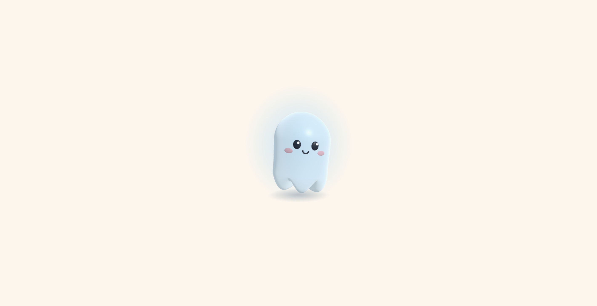

# Blobby 3D 👻

a little translucent, jelly-like ghost who peeks in from the edge of the screen,
waddles to the middle, hops, twirls, and waltzes away.

This is the 3D version of [blobby](https://github.com/sediesimpson/blobby).

**[watch blobby](https://sediesimpson.github.io/blobby-3d/)**



## how it's made

- **Three.js** for the 3D scene, camera, lights and rendering
- **One sculpted sphere** for Blobby's body, so there are no seams
- **A jelly wobble** that reshapes his body every frame, with his top trailing behind as he moves
- **A timeline written in JavaScript** with easing, like CSS keyframes rebuilt by hand
- **Squash and stretch, anticipation and follow-through**, three classic animation principles

## the show

1. **Peek**: leans in from the left edge, with a curious head tilt
2. **Waddle**: a sqgeuishy walk to centre sta
3. **Hop, hop, twirl**: two big bouncy hops and a full 3D spin
4. **Waltz**: glides off to the right in 3/4 time, turning as he goes

If your computer is set to reduce motion, Blobby skips the show and stands calmly in the middle instead.

## run it yourself

```
git clone https://github.com/sediesimpson/blobby-3d.git
cd blobby-3d
python3 -m http.server
```

Then open http://localhost:8000 in your browser.